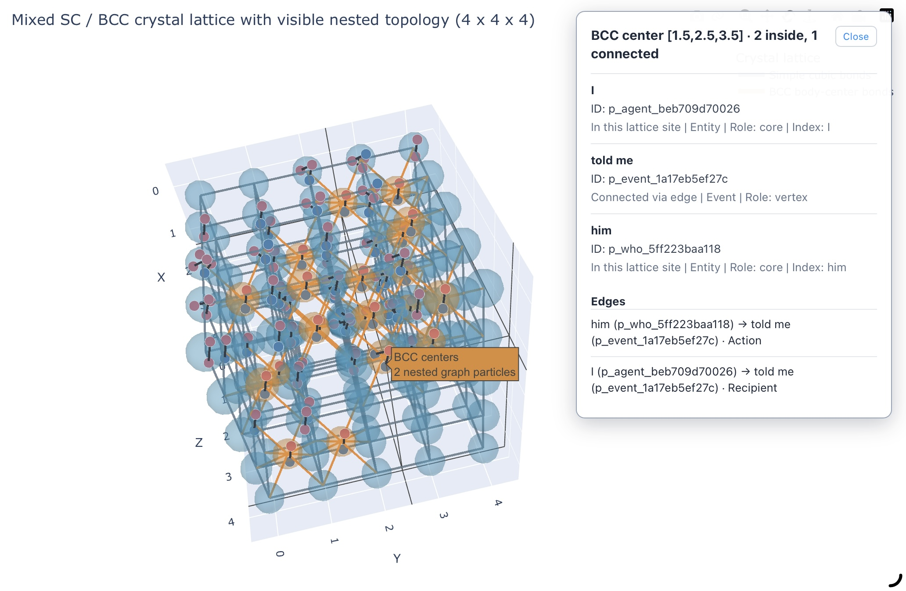

# Spatial-Allocation Engine

A deterministic, category-theoretic spatial allocation and layout calculation engine for cognitive topology and semantic event networks. 

This repository serves as the spatial positioning layer, taking the pure topological graph (Nodes & Morphisms) generated by [topological-mapper] and computing multi-dimensional coordinates ($x, y, z$) for visualization and structural analysis.

## Semantic Axes

The 3D allocator uses the input node attributes and directed morphisms as follows:

- **X — What / topic proximity:** a deterministic one-dimensional projection of TF-IDF cosine distances between `attributes.what` values. This captures lexical overlap, not full language-model semantics. Missing `what` values are placed at the median x position and are not treated as semantic matches.
- **Y — Causal / hierarchical depth:** the longest directed path of `Cause` and `Hierarchy` morphisms from a root. Cycles are treated as a single depth level.
- **Z — Process stage:** directed `Temporal` morphisms (source precedes target) and optional numeric `attributes.stage`, `attributes.stage_index`, or `attributes.process_stage` values establish ordering. ISO-formatted `attributes.when` values can also establish order when no explicit stage is given. Free-text `when` values are not guessed to be chronological; nodes without ordering evidence remain at the baseline.

`attributes.where` is retained as contextual information rather than used as an axis. `who`, `when`, and `where` are likewise retained in the allocated node data. Temporal relationships and explicit stage values must not conflict; cyclic temporal relationships are collapsed into one stage.

Each connected component is placed in a container particle, and its topology is embedded on a discrete inner lattice. A labeled `Entity` directly connected to an `Event` with non-empty `*_mapping` data becomes a core/index and is assigned to the BCC body-center site; mapped Events are assigned to vertex sites. Otherwise the component uses a simple cubic (SC) lattice, the neutral choice for unstructured topology. A component's `attributes.lattice_mode` may explicitly override the inferred mode with `simple_cubic`, `body_centered_cubic`, `sc`, or `bcc`. The allocator retains this topology-allocation output as `data/topological_graph_3d.json`.

The GitHub Pages visualization renders each `Shared lattice vertex` and `BCC center` itself as a translucent 3D capsule sphere; there is no separate capsule layer. Graph particles and edges from `data/topological_graph.json` are positioned inside their site capsules and visible from the start, so the topology can be seen within the full lattice without clicking. Hover over a particle for a quick look, or click a populated lattice capsule to open its details. The panel distinguishes particles assigned to that lattice site from edge-connected particles, and lists their IDs, labels, categories, roles, and connecting edges. SC components are nested only in shared lattice vertices. In BCC components, mapped `Entity` index particles occupy body-center capsules and the other graph particles occupy vertex capsules. The number of unit cells grows as needed to provide a cell for every connected component.

---

## Design Philosophy

In cognitive architectures, semantic understanding is not merely a flat collection of words, but a structured topological space. **Spatial-Allocation** bridges the gap between abstract categorical relationships (Actions, Causes, Temporals, etc.) and explicit spatial coordinates, enabling:
- **Topological Preservation:** Maintaining cluster density and local event proximities during layout calculation.
- **Deterministic Coordinate Mapping:** Avoiding pure stochastic noise by anchoring spatial distribution to structural morphism weights.
- **Multi-Layer Dimensionality:** Supporting temporal or inferential depth across spatial axes (e.g., mapping inference stages onto the $Z$-axis).

---

## Project Structure

```text
Spatial-allocation/
├── data/
│   ├── topological_graph.json       # Input topology
│   └── topological_graph_3d.json    # Generated coordinates
├── docs/
│   └── index.html                   # GitHub Pages visualization
├── src/
│   └── allocator.py                # 3D coordinate allocation
├── visualize/
│   └── render_3d.py                # Interactive Plotly renderer
├── requirements.txt
└── README.md
```

## Getting Started
Install the dependencies, then generate coordinates (optional for the lattice visualization) and the interactive page:

```bash
python -m pip install -r requirements.txt
python visualize/render_3d.py

# Optional: generate the topology allocation output
python src/allocator.py
```

The renderer reads `data/topological_graph.json` and writes the interactive page to `docs/index.html`. The optional allocator writes coordinates to `data/topological_graph_3d.json`.
## Pipeline Workflow
```text
[topological-mapper] -> data/topological_graph.json
    -> python visualize/render_3d.py -> docs/index.html (mixed SC/BCC lattice with visible nested topology)
    -> python src/allocator.py -> data/topological_graph_3d.json (optional topology allocation)
```
## Tech Stack
- Language: Python 3.x
- Graph Processing and Layout: NetworkX
- Interactive 3D Visualization: Plotly
- Numeric Computation: NumPy

To publish the visualization with GitHub Pages, select **Deploy from a branch**, choose the `main` branch, and set the folder to `/docs` in the repository's Pages settings.